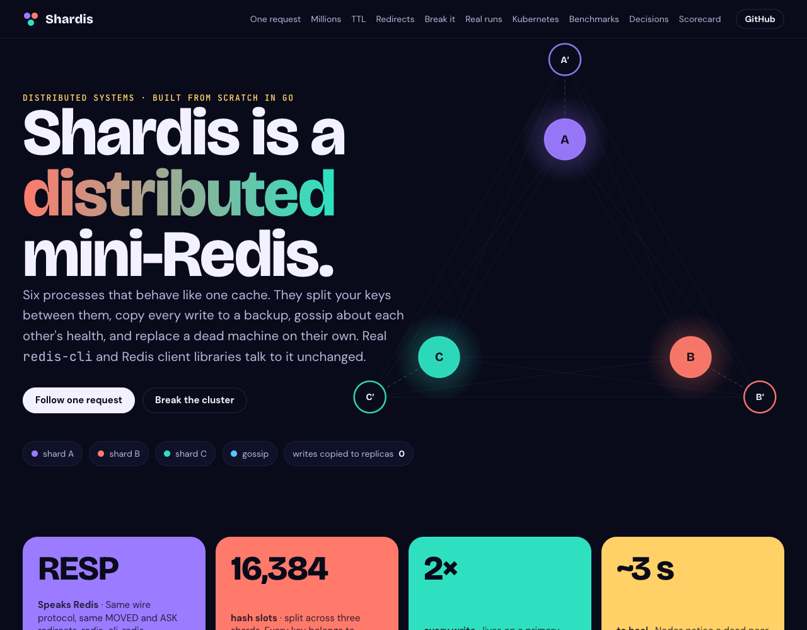
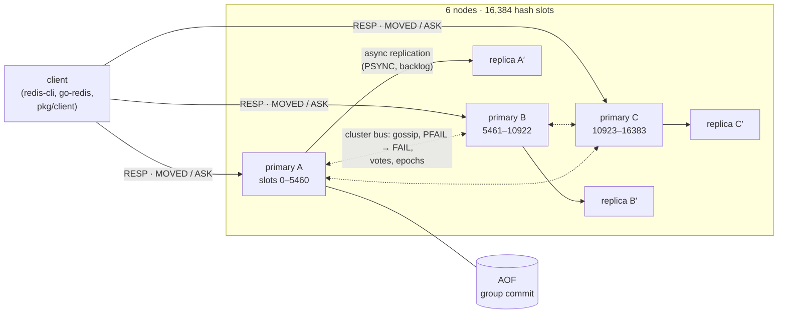

# Shardis

**A distributed mini‑Redis, built from scratch in Go.** Six processes behave like one cache:
they split keys across 16,384 hash slots, copy every write to a replica, gossip about each
other's health, and replace a dead primary on their own. It speaks the real Redis protocol,
so `redis-cli`, `redis-benchmark` and `go-redis` work against it unchanged.

It also measures where it breaks. Redis Cluster isn't strongly consistent, and neither is
Shardis. Every way it can lose a write was reproduced, counted and written down.

**[▶ The interactive site](https://djism.github.io/shardis/)** · [Design doc](docs/DESIGN.md) ·
[51 design decisions](docs/decisions/) · [Benchmarks](docs/benchmarks/) ·
[Learning log](docs/learning-log.md)

[](https://djism.github.io/shardis/)

## In 30 seconds

| | Measured |
|---|---|
| Heals without a human | failover in **2.3 s / 3.1 s / 7.2 s** (median of 20 runs) at 1 / 2 / 5 s node timeouts |
| Clients barely notice | **0 client errors in 1.2M operations** across 7 chaos scenarios (crashes, partitions, flapping links, resharding mid-failover) |
| Restarts lose nothing | SIGTERM hands slots to the replica in **13 ms**; a full Kubernetes rolling restart under load: **0 lost writes in 1.1M ops** |
| Grows while serving | 4,096 slots moved to a new node under load with **0 client errors** (800 MOVED + 35 ASK redirects followed) |
| Fast per node | **1.46M SET/s pipelined** vs Redis 8.10's 1.01M (256 lock groups instead of one thread); 9% slower unpipelined |
| Honest about loss | a partitioned primary rolled back **2,029 acknowledged writes** on Kubernetes; async replication loses the in-flight tail, which `WAIT` closes |

## Run it in 2 commands

```sh
make cluster-up-local                       # builds, starts 6 nodes on 127.0.0.1:7000-7005
redis-cli -c -p 7001 set user:42 hello      # -c follows MOVED to whichever node owns the slot
```

Then break it: `kill -9 $(cat .cluster-local/a.pid)` kills primary a, and
`redis-cli -p 7001 cluster nodes` shows its replica d taking over: about 3 s if you started with
`SHARDIS_CLUSTER_NODE_TIMEOUT=2000 make cluster-up-local`, 15–20 s with the default 15 s timeout.
`make cluster-down-local` stops everything. Requires Go 1.26+ and `redis-cli`. You can also use Docker (`make cluster-up`) or Kubernetes
(`deploy/k8s/demos/up.sh` on minikube).

## Architecture



Inside each node:

```
 TCP ─► RESP parser ─► command table ─► slot check ─────────► store: one map per slot,
        (internal/resp)  (internal/server)  MOVED / ASK /       256 lock groups, TTL index,
                                            per-slot gate        approximate LRU
                                                │                    │
                       cluster bus ◄────────────┤                    ├─► AOF (fsync policy)
                       gossip, failure          │                    └─► replication stream
                       detection, elections     └─► event bus ─► EVENTS / observer / traces
```

## What's in here

| Path | What it is |
|---|---|
| `internal/resp`, `internal/server` | RESP2 parser/writer (fuzzed), connection loop, command table |
| `internal/store` | keyspace (one map per slot), sharded-lock engine, lazy + sampled expiry, approximate LRU, random and TTL eviction, DUMP format |
| `internal/persist` | append-only file with group commit, `always`/`everysec`/`no` fsync, background rewrite |
| `internal/replication` | PSYNC full/partial sync, backlog, `WAIT`, promotion |
| `internal/cluster` | cluster bus, gossip, PFAIL/FAIL quorum, replica elections, epochs, minority detection, live resharding (`MIGRATE`/`ASK`) |
| `pkg/client` | smart cluster client: slot map, MOVED/ASK, retry budget with jittered backoff, retry-safety by command |
| `cmd/shardis-chaos` | 7 chaos scenarios on real processes + a history checker (lost and stale reads) |
| `cmd/shardis-crashtest`, `-loadgen`, `-admin`, `-observer` | crash/failover/partition testers, Zipf load, cluster ops, live WebSocket feed |
| `deploy/k8s` | StatefulSet, headless Service, PDB, NetworkPolicy, bootstrap Job, demo scripts |
| `website/` | the showcase site (React + Vite + canvas), with recorded traces |

## Testing

```sh
make test        # go test -race ./... (unit, integration, in-process 3+3 clusters)
make chaos       # 7 scenarios against real processes, ~5 min, writes traces + a report
make fuzz        # RESP parser and DUMP decoder
make web-test    # site: CRC16 vectors shared with Go, replay model, ADR parser
```

All protocol work was implemented from the public RESP and Redis Cluster specs. No Redis
source code was used.

## What it doesn't do (yet)

Strings only (no lists, hashes or sets), no MULTI/EXEC or pub/sub, no auth or TLS, and no
strong consistency, by design. The [scorecard on the site](https://djism.github.io/shardis/#score)
and [DESIGN.md § Failure modes](docs/DESIGN.md#7-failure-modes) list everything that hurts.
