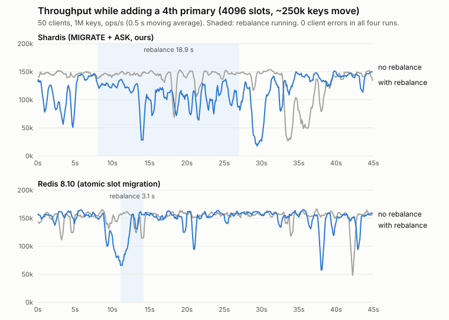

# Iteration 11: live resharding under load

**Setup:**
- **Machine:** Apple M4 (10 cores, 16 GB), macOS 26.6, Go 1.26.1, Redis 8.10.1. During these runs
  the Mac was **under heavy memory pressure** (30.6 of 31.7 GB swap in use). That causes
  machine-wide freezes of up to 2.5 s, which are visible in the control runs too. Read single
  dips with that in mind.
- **Cluster:** 3 primaries + 3 replicas, node timeout 5 s, no persistence.
- **Load:** 1M keys preloaded (100-byte values). `shardis-loadgen -cluster` runs 50 clients with
  Zipf GETs through our `pkg/client`, which follows MOVED and ASK, for 45 s. It records
  throughput, errors, redirects and latency every 100 ms.
- **The change under load:** a 4th, empty primary joins and the cluster is rebalanced onto it
  (4096 slots, ~250k keys move).
  - Shardis: `shardis-admin add-node` + `rebalance`.
  - Redis: `redis-cli --cluster add-node` + `rebalance --cluster-use-empty-masters`.
- **Control:** each system also runs once with the same load and no rebalance.

Reproduce: `bash docs/benchmarks/iter-11-resharding/run.sh` (~6 min). Then `python3 summarize.py`
and `python3 chart.py`. Raw: `*-timeline.csv`, `phases.csv`, `summary.txt`.

| | rebalance took | client errors | redirects followed | throughput during rebalance (median, vs control) | p99 during rebalance (median of 100 ms windows, vs control) |
|---|---:|---:|---|---|---|
| **Shardis** | **18.9 s** | **0** | 800 MOVED, 35 ASK | 117.6k/s vs 147.4k/s (**−20%**) | 2.18 ms vs 1.28 ms |
| **Redis 8.10** | **3.1 s** | **0** | 66 MOVED, 0 ASK | 132.6k/s vs 155.8k/s (−15%) | 1.86 ms vs 1.15 ms |

Both rebalances end with 4096 slots on each primary. Keys moved by Shardis: 249,563.

## What this tells us

1. **The goal is met: zero client errors, only redirects.** All the client saw was 800 `MOVED`
   (a slot finished moving: update the map) and 35 `ASK` (this one key already moved: try the
   target, once). The ASK count is small because Zipf traffic mostly hits keys that haven't
   moved yet. `TestMigrateUnderConcurrentWrites` checks the harder thing, correctness: 8 writers
   INCR keys in a migrating slot, and every acknowledged INCR is on the target afterwards.
2. **It costs about 20% throughput while it runs.** The rebalance competes for CPU with the
   clients on the same 10 cores: every slot is ~10 round trips plus a MIGRATE per 100 keys,
   and the source's gate makes that slot's clients wait out each batch (ADR 033). p99 goes from
   1.3 to 2.2 ms. In 5 of the 189 windows (100 ms each) throughput fell below 20k/s. The control
   had none this time, but earlier control runs on this machine froze for 2.5 s, so those dips
   can't be blamed on migration alone.
3. **Redis 8.10 is 6× faster at this, because it moves slots differently.** Its `redis-cli`
   no longer uses key-by-key MIGRATE (no ASK at all). It uses **atomic slot migration**: the
   source streams a snapshot of a whole range (~1365 slots) plus the writes made since, pauses
   writes for a moment, and the range changes owner in one step (the Redis logs say "Migrate task
   ... slots=0-1364 ... pausing writes for slot handoff"). That's the "bigger scale" design in
   ADR 032. We built the classic protocol on purpose: it's what the cluster spec describes and
   what every client handles.
4. **The cost of the gate on normal traffic is too small to measure.** 1.27M vs 1.31M SET/s and
   1.36M vs 1.39M GET/s, before vs after, within noise ([gate-overhead.txt](gate-overhead.txt)).

## Things we found along the way

- **Real Redis answered `CLUSTERDOWN` for ~1.4 s during a rebalance** in our first runs:
  50 errors, one per client. The cause: `redis-cli --cluster add-node` returns while the new
  node still reports `cluster_state:fail` (it takes a few seconds to settle). The rebalance
  handed it slots ~100 ms later, clients were MOVED to it, and it answered CLUSTERDOWN until its
  state turned ok. We confirmed this by polling every node's `cluster_state` during a rebalance.
  The script now waits for the new node's `cluster_state:ok` before rebalancing (both systems).
  An operator should do the same.
- **Our first `shardis-admin add-node` returned too early.** It waited only until the node it
  introduced the newcomer to knew it. The rebalance then asked a different primary to migrate a
  slot to a node it hadn't heard of yet ("I don't know about node ..."). Fixed: add-node waits
  until *every* node knows the newcomer, and reshard/rebalance check that all primaries agree
  before moving anything.
- **`redis-cli --cluster reshard` and `rebalance` work against Shardis.** They use the same
  MIGRATING/IMPORTING/MIGRATE/SETSLOT commands, and all keys survive. Right after a rebalance,
  `redis-cli --cluster check` briefly reports "Nodes don't agree": the replicas learn the new
  owners by gossip and catch up within 1–3 s. Redis shortens this with UPDATE messages, which we
  haven't built yet.
